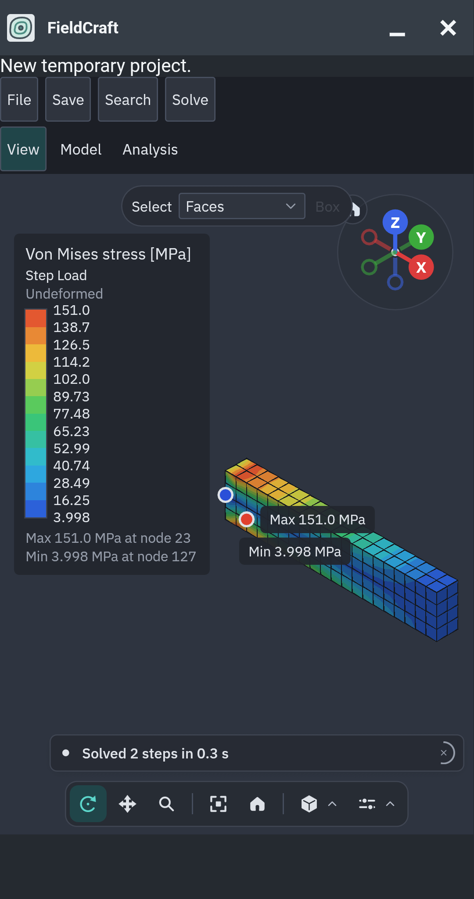
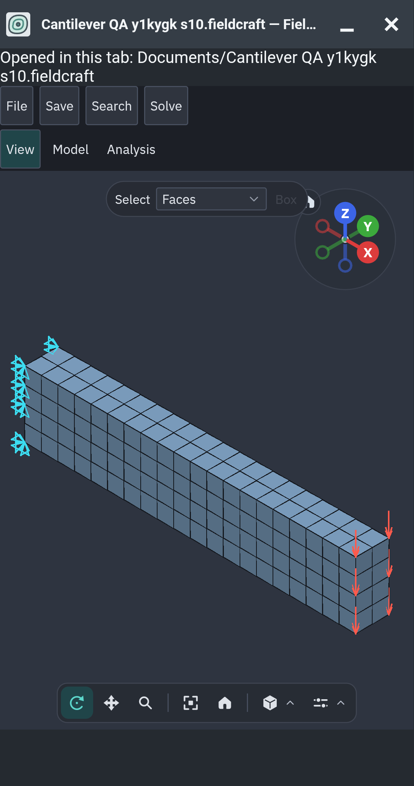
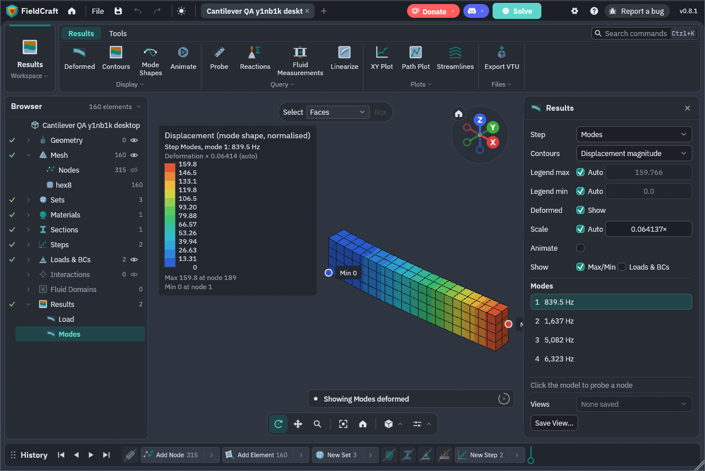

# FieldCraft in WebOS

The November 26, 2026 check used FieldCraft source `b89311fca381752d871c2cd874128e79228b7e6b` and viewer `c30ba950829b52fc2caf07349857e24f27abdcc7c83380f7cb2a29475338beff`. The viewer ran on ksu.codes and in an isolated installation with the same browser assets. FieldCraft's editable file extension is `.fieldcraft`. Guests use temporary My files storage for the browser session. A signed-in user can save to account My files and reopen the project from a fresh session.

Open **CAD → FieldCraft** from the WebOS app menu. The source builds from `apps/fieldcraft-web` via Trunk with the locked Rust dependencies and WASM tools. Use the built site as the WebOS `--fieldcraft-site` input. The current browser package was built with Rust 1.99.1. [FieldCraft browser build steps](../web.md)

## Galaxy S10+ workflow

1. Open **File → Samples** and scroll to **Cantilever**. Its model shows a clamped steel beam with an end load.
2. Tap **Solve**. The status reports two solved steps. The Von Mises stress plot shows a 151.0 MPa maximum for the sample.
3. Tap **Save** and cancel the folder picker. The analysis stays open. Save again, select **Documents**, and type a bare name. WebOS adds `.fieldcraft` automatically.
4. Close FieldCraft, open **My files**, select the named project in **Documents**, and tap **Open**. FieldCraft opens the editable model. In the signed-in test this step used a fresh browser session.

The physical Galaxy S10+ used Chrome `158.0.8127.92` at 411 CSS pixels in portrait. The hosted guest and isolated signed-in runs passed the four steps. In the signed-in run, **Analysis → Export CSV** downloaded the reaction table on Android. The Moto G 5G used Chrome `158.0.8127.42` at 822 CSS pixels in landscape for a supplemental isolated guest pass. Its ribbon and Results pane use much of the short viewport and can obscure part of the plot.

## Workflow coverage

| Workflow | S10+ portrait | Desktop Chromium, 1300 CSS pixels |
| --- | --- | --- |
| Load the Cantilever sample for analysis | Passed | Passed |
| Review the mesh, loads and constraints | Passed. The model displays the clamp and end load. | Passed. The model tree displayed 315 nodes, 160 hex8 elements, and two entries under Loads & BCs. |
| Solve the load and frequency steps | Passed | Passed, including rerun after reopen |
| Switch between the static and modal result views | Pending | Passed. The first displayed mode was 839.5 Hz. |
| Navigate the model with zoom and fit | Pending | Passed |
| Cancel and retry a named editable save | Passed | Passed |
| Preserve the original by saving a separate copy | Pending | Passed |
| Close and reopen the editable project through My files | Passed | Passed in a fresh signed-in session |
| Change the mesh and undo the edit | Pending | Pending on this release |
| Export a result table | Passed on Android. The downloaded CSV matches the desktop CSV. | Passed. The table reports approximately +1,000 N at the clamp and −1,000 N applied. |

The four verified guest and signed-in Cantilever files matched byte for byte. The selected workflows passed at 6 of 10 on S10+ portrait and 9 of 10 in desktop Chromium. Each contained the static `Load` and frequency `Modes` results, the `Clamp` constraint and the `Push` load. The measured maximum displacement was 0.244562 mm. The test compared it to a 0.238095 mm beam calculation and used the source test's ten-percent upper tolerance.

Chromium emulation at 820 × 1050 CSS pixels kept the WebOS app bar visible. A touch-only Files reopen restored the exact document, and the toolbar’s Solve button ran both steps. The portrait Analysis panel leaves very little room for the solver status. Tap **View** to return to the unobstructed plot.

## Open issues

The S10+ isolated Chrome session solved **File → Samples → Hex-Meshed Bracket**. Saving the resulting 30,623,712-byte project to a signed-in account returned `File verification worker failed`. The worker reported Chrome `NotReadableError` before upload. The analysis remained open in the editor. The smaller editable Cantilever saved successfully in the same Chrome version. A regular Chrome tab on the S10+ saved the same bracket file to the isolated account and reopened it from My files. The saved checksum matched the browser read. The Moto reproduced the browser-session difference with a synthetic file of the same size. Use a regular Chrome tab when saving larger projects. The isolated-session error still needs clearer recovery guidance.
